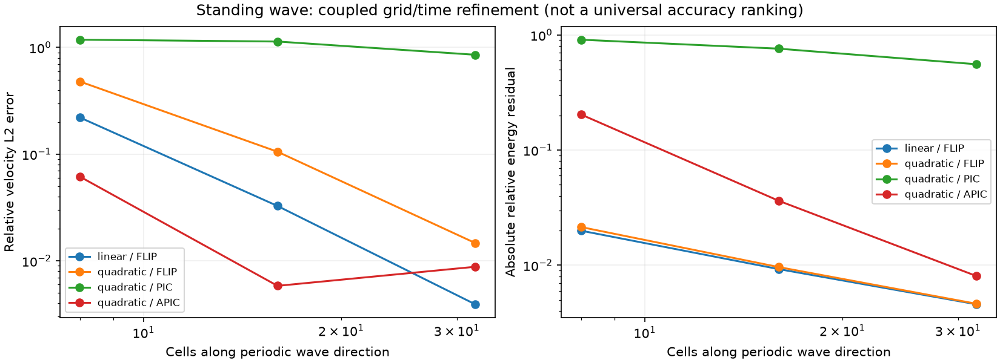

# Numerical methods

The solver uses explicit strain-before-force MPM on a regular Cartesian grid,
with selectable linear/quadratic interpolation and FLIP, PIC, or APIC transfers.
Deformable materials evolve deformation, volume, density, and constitutive state.

## Selecting a configuration

Run the quadratic/APIC example:

```sh
uv run --locked python MPM.py modern_ball
```

This uses updated mechanics, quadratic B-splines, APIC, and dynamic timestepping.
The `ball` example uses linear interpolation and FLIP, but also uses
updated mechanics. In a custom `Params` constructor, select:

```python
self.mechanics = 'updated'       # default
self.interpolation = 'quadratic' # default: 'linear'
self.transfer = 'apic'           # default: 'flip'; alternatives: 'pic', 'apic'
self.time_stepping = 'dynamic'
self.CFL = 0.15
```

APIC is supported with quadratic interpolation and planar motion (`v_z=0`,
`initial_C` has zero z row/column). The known degenerate-support instability of
linear APIC is avoided by rejecting that combination explicitly. For a PIC/FLIP
blend, use `transfer='flip'` and `pic_fraction` between zero (pure FLIP, the
default) and one (PIC). Changing transfer changes numerical dissipation.

`mechanics='legacy'` is an explicit compatibility configuration with incremental
constitutive equations, fixed volume, occupancy-based density, Lie stress
correction, and acceleration-only FLIP. The default `updated` configuration is
the one described below.

## Deformation and physical density

Each deformable particle stores `F` (3 by 3), `J=det(F)`, reference volume `V0`,
and current volume `V`. With the gathered velocity gradient `L`, the update is

```
F_new = exp(dt L) F_old
V = J V0
rho = m/V
```

The exponential preserves pure rotation and avoids the artificial volume growth
of `F_new=(I+dt L)F_old` under spin. Invalid/nonfinite or nonpositive determinants
fail with material, timestep, and particle indices. Particle mass remains constant
except for explicit inlet/outlet events. Inlets start from `F=I`, `J=1`, fresh
material history, and their specified initial state; every persistent field moves
with particle rows through removal and insertion.

The reference is the input configuration: pressure initialisation supplies an
initial prestress, not an inferred pre-deformation. Physical density follows
mass/volume; nodal mass divided by nodal control volume remains a separate grid
occupancy diagnostic. No separate porosity or critical-state dilation law is implied.

## Volumetric locking and F-bar

Particle quadrature samples the volumetric strain rate at every particle, which
over-constrains nearly incompressible materials: the discrete velocity field
cannot change volume freely, and bending is too stiff. `fbar = True` (explicit
solver, updated mechanics, default off) replaces each particle's in-plane
volumetric rate `tr(L)` by its volume-weighted projection through the
material's grid nodes,

```
d_i = sum_p N_ip V_p tr(L_p) / sum_p N_ip V_p
tr(L_p) <- sum_i N_ip d_i
```

and adds half the difference to each in-plane diagonal entry of `L`. The
deviatoric part of `L` is unchanged, `F`, the strain increment and every law see
the averaged volume change, and partition of unity keeps each material's total
`sum_p V_p tr(L_p)`. Materials are averaged separately, so an interface between
them is not smoothed. Affine motion is reproduced exactly.

The benchmark (`benchmarks/locking_cantilever.py`, report
`benchmarks/locking_cantilever.json`) loads a plane-strain elastic cantilever
(length 1 m, height 0.125 m, four cells through the height, `E = 1e8` Pa) by
gravity from rest at a no-slip wall. The static tip deflection is the midpoint
of the tip's extremes over 1.5 analytical periods, compared with
Euler-Bernoulli `1.5 rho g L^4 / (E' h^2)`, `E' = E / (1 - nu^2)`:

| nu | Steps | Without F-bar | With F-bar |
| --- | ---: | ---: | ---: |
| 0.3 | 8,771 | 0.986 | 1.035 |
| 0.49 | 28,579 | 0.598 | 0.954 |
| 0.499 | 88,778 | 0.148 | 0.941 |

Without F-bar the beam locks as `nu` approaches 0.5; with it the deflection
stays within 6% of the beam theory, which itself neglects shear deformation.
This is one geometry at one resolution; F-bar has not been checked for
plasticity, finite rotations at large strain or mixed-material interfaces.

## Stress and work conventions

All Cauchy stresses are tension positive. Geometry remains 2D/plane strain, with
three-component vectors and 3-by-3 constitutive tensors.

**Elasticity** in updated mode is compressible, isochoric/volumetric neo-Hookean
elasticity with reference prestress `S0`. For `b=F F^T`, `bbar=J^(-2/3)b`,

```
W0 = G/2 (tr(bbar)-3) + K/2 (ln J)^2 + S0:(F^T F-I)/2
sigma = [G dev(bbar) + K ln(J) I + F S0 F^T]/J
elastic_energy = V0 W0
```

`S0` is the initial Cauchy stress at `F=I`, stored as `reference_stress`.
This recovers the supplied initial stress and isotropic linear elasticity about
an unstressed reference. Energy is measured relative to that reference;
prestress work can make its change negative. The Cauchy stress matches the
energy derivative, which is checked by finite differences.

**Von Mises** uses a standard perfectly plastic J2 return map. Supply
`yield_stress` in Pa, or retain `k` with `yield_stress=sqrt(3)*k`. `s` only applies in compatibility mode. **DP/DP-rate** use cone/apex return
maps. These rate-form plastic solids use the symmetric spin split and accumulate
plastic strain and nonnegative plastic work. Their elasticity remains
hypoelastic, not a multiplicative finite-strain plasticity formulation. Their
quadratic elastic-energy diagnostic is an estimate; finite-strain plasticity
remains on the implementation checklist.

**Viscous/Bingham/Pouliquen/linear-mu** fluids prescribe current viscous stress.
They use engineering shear rate `sqrt(2 D':D')`, bulk-pressure increments
`K tr(dstrain)`, and nonnegative shear/bulk dissipation. Pouliquen uses its bounded
friction function and actual current density. No Lie correction is added to these
algebraic stresses.
Bulk elastic work is integrated along the exponential volume change, including
the no-tension cutoff where present; `pressure` history excludes the instantaneous
bulk-viscous mean stress. Local rheology still needs application-specific
calibration and has the limitations described in the constitutive reference.

## Interpolation and physical boundaries

The stencil interface returns node indices, weights, gradients, and physical
node-minus-particle offsets. With point quadrature, linear interpolation uses
four entries and quadratic uses nine. Finite-domain integration uses wider
stencils as required by the particle geometry. Force mapping, diagnostics, deformation, momentum, composition, and
segregation all use the returned support size.

The quadratic interior uses tensor products of cardinal quadratic B-splines.
At physical boundaries, ghost **values** are linearly extrapolated through the
boundary nodes, and their basis contributions are combined onto physical nodes.
In the outer half-cell this reduces to linear weights. The join is C1, weights
are nonnegative, and partition/affine completeness are preserved, including at
corners. This is a boundary-modified cardinal quadratic basis. Domain quadrature
averages this same basis over the represented particle domains.
The method still has quadrature and boundary errors. The motivation for smooth
interior basis functions is discussed by
[Steffen, Kirby and Berzins](https://doi.org/10.1002/nme.2360).

Periodic x support deposits onto unique nodes while retaining **unwrapped** local
offsets for affine transfer. The stored endpoint column remains a duplicate for
existing grid operators. Global angular momentum computed from wrapped particle
positions is not an unwrapped periodic-domain angular budget.

Missing mass support is not silently repaired by renormalising weights. Constant
velocity is extended onto massless derivative-only support so a sparse particle
at a grid node does not acquire spurious strain under translation. APIC also uses
its resolved affine extension. Such support is reported; nonzero stress forces
requiring massless support fail explicitly. Add particle coverage or review the
mass threshold instead of discarding forces.

## Particle quadrature

`quadrature='point'` evaluates the basis at particle centres. The optional
`quadrature='domain'` configuration averages it over F-convected reference
rectangles, using the same averaged weights/gradients throughout the timestep.
Each material must provide `domain_size` consistent with `A`. See
[finite-domain quadrature](quadrature.md) for setup, conservation properties,
controlled comparisons, boundary restrictions and computational cost.

## Matched APIC transfers

Each APIC particle carries affine momentum `B` (stored as `affine_momentum`),
not just a velocity gradient copied from the stress calculation. With offsets `r`,

```
D = sum_i N_i r_i r_i^T
C = B D^+
q_i += m N_i (v + C r_i)
v_new = sum_i N_i v_i_new
B_new = sum_i N_i v_i_new r_i^T
```

`D^+` is the pseudoinverse on resolved planar support. This is the matched
explicit APIC transfer described in the [APIC work](https://arxiv.org/abs/1603.06188),
using the current stencil moment rather than assuming an interior constant.
Optional material `initial_C` is `(3,3)` or `(n,3,3)` and seeds `B=C D`.
The particle's angular momentum includes the antisymmetric part of `m B`.
Omitting this term gives an incorrect conservation check.

Rank-deficient support accepts resolved affine states. If a changed support
would discard a nonzero unresolved affine component, the transfer fails rather
than silently losing angular momentum. There is no arbitrary inverse-moment
ridge. APIC reduces PIC's transfer dissipation; it does not remove all remapping,
integration, or quadrature errors.

FLIP takes the complete nodal velocity change from pre-constraint P2G to
the final grid velocity. Thus a wall's velocity projection reaches particles.

## Timestep estimates and diagnostics

Dynamic stepping additionally considers particle speed, elastic waves, viscosity,
segregation advection/diffusion, and material-specific limits **before the first
step** and subsequently. `CFL` scales the central estimates. Neo-Hookean waves use a deformation-dependent norm bound on the reference
energy Hessian, pushed to the spatial configuration; plastic solids use their
elastic wave estimate. These and the explicit transport estimates remain local
restrictions, not a universal nonlinear stability proof.
Plastic relaxation is integrated locally by the implicit return map.

Static stepping retains the supplied `dt` and reports its estimated restrictions.
Set `timestep_policy='enforce'` to reject a static step above those estimates;
it does not silently change `dt`. Dynamic stepping limits the step instead.
Final-time remainders within floating-point tolerance do not produce an extra step.

Diagnostics run independently of plotting. Inspect `L.diagnostics.last` or
`.history`. Set `diagnostics=False` to disable them, or `diagnostics_stride=100`
to retain fewer rows while still accumulating work and recording the final state.
With output enabled, `O.save_diagnostics=True` (default) writes
`data/diagnostics.json`, even when an input has custom plotting callbacks.
`output=False` keeps diagnostics in memory but writes no files.

The ledger records mass/species inventory, momentum, APIC angular momentum and
represented kinetic energy, material work, stored-energy estimates, plastic and
viscous work, external work/impulses, constraint work/impulses, numerical force
scaling, boundary inventory/energy changes, density/J ranges, support deficiencies,
and timestep restrictions. The legacy `damping=True` force multiplier is recorded
as numerical force scaling, not labelled physical damping.

Energy residuals are measured, not forced to zero. They include transfer and time
integration error. `stored_energy_exact` distinguishes the implemented elastic/
fluid work potential from the plastic models' energy estimate. Prescribed rigid
motion has unaccounted actuator work, so its budget is flagged incomplete.
Periodic angular checks require unwrapped geometry and are flagged accordingly.
The `measure_energy` plot is a separate potential-energy estimate;
use the diagnostics ledger for conservation verification.

## Evidence and limits

`tests/test_modern_solver.py` checks completeness/derivatives at edges and corners,
cell-crossing gradient continuity, affine deformation, rotation, volume/density,
stress/energy derivatives, fluid and plastic work, affine APIC reproduction,
transfer momentum/angular momentum and energy filtering, full-step torque-free
motion, constraints, sparse support, timestep enforcement, inlets, and segregation
with nine-node stencils.

Run the reproducible wave study from the checkout:

```sh
uv run --locked python -m benchmarks.verification --output /tmp/poly-mpm-verification.json
```

The committed `benchmarks/verification.json` contains all configurations and levels,
including PIC's large remapping loss and non-monotone levels caused by competing
phase/transfer errors. It includes coupled grid/timestep refinement, fixed-step
spatial comparisons, and fixed-grid timestep comparisons. Remapping frequency
changes when `dt` changes, so the latter is not a pure time-integrator order test.
At 32 cells, the coupled quadratic/APIC velocity error is below 2%; it is not an
accuracy guarantee for other problems. See [verification](verification.md) for
hydrostatic, translated-stress, large-deformation, and operator-isolation studies.
Finite-strain plasticity, contact, and experimental validation remain separate work.



The report also records full `modern_ball` and `dp_rate_unit_test` runs. These
bounded/full examples do not establish convergence of every application.
