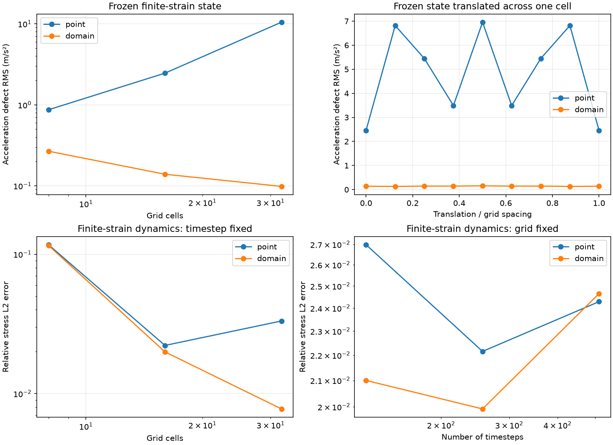

# Finite-domain quadrature and cell crossing

`quadrature='domain'` integrates the grid basis over each particle's represented
area. It reduces the sensitivity of internal forces to distorted integration
points crossing grid cells. `quadrature='point'` is the default and requires no
particle-domain geometry. Select the integration method independently of linear
or quadratic grid interpolation and FLIP/PIC/APIC transfer.

Use a source checkout for domain quadrature and its benchmarks. The published
`1.0.0` package provides point quadrature.

## Configuration

In the input's `Params` constructor, set

```python
self.quadrature = 'domain'
self.interpolation = 'quadratic'
self.transfer = 'apic'
self.S.domain_size = [particle_spacing_x, particle_spacing_y]
self.S.A = particle_spacing_x * particle_spacing_y
```

For multiple materials, declare `domain_size` on every material. Widths are in
metres in the reference configuration: `(2,)` for a uniform rectangle or `(n,2)`
for per-particle rectangles. Widths must be finite and positive and their product
must equal the represented area `A`. The solver does not infer aspect ratio or a
material boundary from area alone. Provide domains that represent the intended
material region; overlapping or incomplete initial coverage is not repaired.

Run a small column example with

```sh
uv run --locked python MPM.py domain_column
```

It uses 256 particles, quadratic interpolation, APIC, a supported base and periodic
x boundaries. Figures and `data/diagnostics.json` are saved under
`im/domain_column/elastic/`. The column measures hydrostatic drift; it does not
impose exact discrete equilibrium.

Domain integration requires updated mechanics, planar motion and fixed thickness.
Inlets require uniform domain sizes and initialise fresh reference geometry and
`F=I`. Outlets remove geometry with the rest of each particle row. The stored
`domain_halfsize` is half the reference width in each direction, shape `(n,2)`.

## Integration and conservation

Reference rectangles are mapped to current parallelograms by the particle's
`F[:2,:2]`, about its centre. Their area is `J*A`; stress and constitutive state
remain constant per particle. The averaged basis is

```
Nbar_i = (1/Vp) integral_domain N_i(x) dV
gradNbar_i = (1/Vp) integral_domain gradN_i(x) dV
```

This is a GIMP-style domain-averaged formulation. See
[Bardenhagen and Kober](https://doi.org/10.3970/cmes.2004.005.477) for domain
averaging and cell-crossing behaviour. The F-convected parallelogram geometry is
discussed by [Sadeghirad, Brannon and Burghardt](https://doi.org/10.1002/nme.3110).
Here the underlying basis is integrated directly over that geometry.

Axis-aligned domains use exact piecewise polynomial integration. Sheared and
rotated domains are clipped at every basis knot, triangulated, and integrated
with a degree-four triangle rule. For the implemented tensor-product linear and
quadratic bases, these rules integrate weights and gradients exactly up to
floating-point error. A single unsplit Gauss rule is insufficient when a domain
crosses a knot.

The same averaged weights and gradients drive mass/momentum deposition, strain,
internal force, diagnostics, composition and segregation. This preserves the
discrete force/strain power pairing. Partition and affine completeness preserve
linear momentum and in-plane torque. Matched APIC uses the averaged stencil's
actual moment matrix; its angular and represented kinetic-energy accounting is
unchanged. Weights and gradients are frozen together during each explicit
strain-before-force timestep.

Support expands with the domain and can exceed four/nine nodes. Periodic support
keeps unwrapped offsets for affine transfer. Physical boundaries use the grid
basis's linear extrapolation. Configurations producing negative integrated
weights fail explicitly; weights are not renormalised to hide an incompatible
wall/domain geometry. Very wide domains are bounded by `domain_max_support`
(default 256 stored stencil entries) and a 128-node-per-axis integration limit.
These limits raise an error rather than truncating the stencil.

Diagnostics record `quadrature`, `interpolation`, `transfer`, `mechanics`, and
`maximum_stencil_entries`, so saved results identify the selected configuration.

## Verification results

Reproduce the controlled comparison with

```sh
uv run --locked python -m benchmarks.quadrature_verification --output /tmp/poly-mpm-quadrature.json --figure /tmp/poly-mpm-quadrature.png
```

The committed `benchmarks/quadrature_verification.json` records environment,
source hashes, every tested level, conservation diagnostics, and per-case elapsed
time. The finite-strain manufactured solution and error metrics are defined in
[verification](verification.md). Both methods use two particles per axis per
reference cell, the same quadratic/APIC configuration and 256 timesteps.

| Grid cells | Point relative stress error | Domain relative stress error |
|---:|---:|---:|
| 8 | 11.70% | 11.55% |
| 16 | 2.22% | 1.99% |
| 32 | 3.32% | 0.78% |

At 16 cells, translating the frozen distorted cloud across one full grid cell
gives acceleration RMS defects of roughly **2.46–6.96 m/s²** with point sampling
and **0.131–0.158 m/s²** with domain integration. This isolates force quadrature
from timestep and remapping errors. All sampled phases are retained in the report.

The 16-cell hydrostatic column's velocity RMS at 0.05 s decreases from about
`6.73e-5` to `4.38e-5 m/s`. The remaining imbalance is measurable. Exact basis
integration does not imply exact integration of a spatially varying stress field
represented by one constant value per particle.



## Scope and remaining work

- Independent affine particle domains can leave gaps or overlap during nonuniform
  deformation. The report measures this geometry error. Shared-corner/topology
  tracking or another quadrature correction needs separate verification.
- Grid refinement improves the tested dynamic finite-strain sequence. It is not
  a general convergence guarantee for arbitrary distorted clouds, free surfaces,
  or material interfaces. The frozen-state error still has geometry and
  piecewise-constant-stress contributions.
- Smaller timesteps still increase remapping frequency. The fixed-grid time
  study remains non-monotone; domain averaging does not replace a consistent,
  higher-order position/deformation integrator.
- Axis-aligned integration is vectorised. Rotated/sheared integration clips and
  triangulates each particle domain and can be much slower. Per-case timings
  include diagnostics and are not universal throughput measurements.
- Wall treatment must keep the integrated stencil admissible. Curved boundaries,
  exact general hydrostatic balance, gap-free domain tracking and multi-body
  contact remain on the [implementation checklist](implementation-todo.md).
