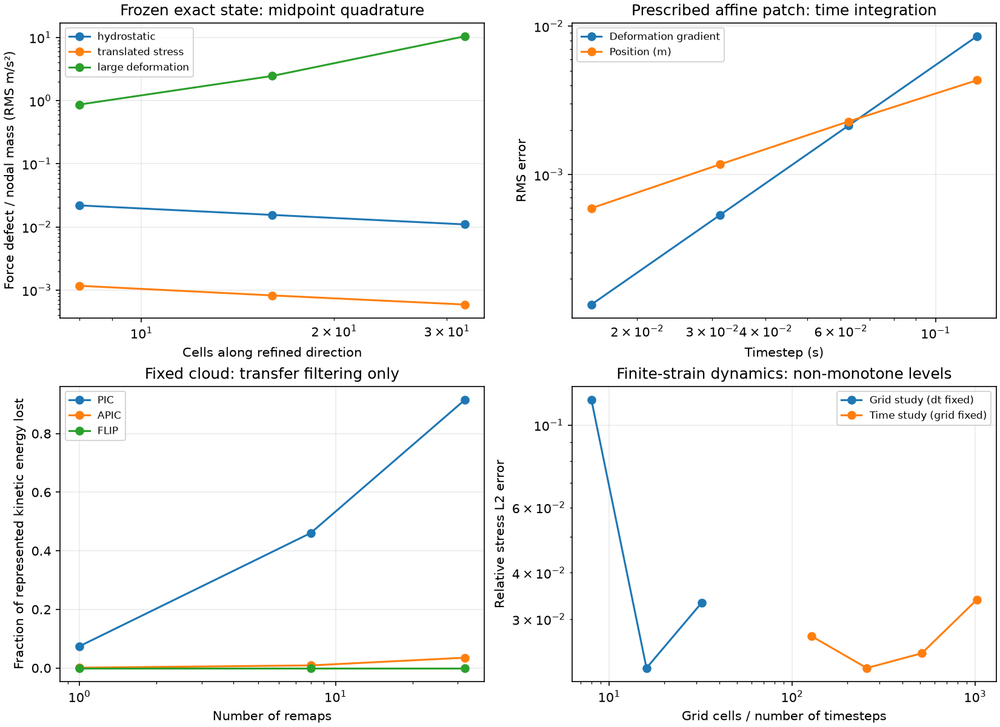

# Verification and error studies

The verification suite checks equations and numerical operators against
analytical references. It measures errors and conservation defects; it does not
establish experimental validity or accuracy for every input. Tests enforce
bounded errors and operator properties. Reports retain every refinement level,
including non-monotone results.

From the checkout root:

```sh
uv run --locked --extra dev python -m pytest -q -W error::RuntimeWarning
uv run --locked python -m benchmarks.broader_verification --output /tmp/poly-mpm-broader.json --figure /tmp/poly-mpm-broader.png
uv run --locked python -m benchmarks.verification --output /tmp/poly-mpm-wave.json
```

Use writable local paths on Windows. The committed report is
`benchmarks/broader_verification.json`; it records the Python/library environment,
source SHA256 fingerprints, configurations, timestep-estimate checks, and errors.
Run times depend on the machine and selected studies.

## Separating error sources

| Study | Fixed controls | What it measures |
|---|---|---|
| Dynamic grid refinement | Final time, timestep, transfer and remap count | Combined interpolation and particle-quadrature error, with a remaining time-error floor |
| Dynamic timestep refinement | Grid, initial cloud, final time and transfer | Coupled stepping/remapping error; a smaller timestep also means more transfers |
| Particle quadrature refinement | Grid, timestep and final time | Sensitivity to particles per cell; two/four/eight midpoint particles per axis |
| Frozen exact-state force balance | Exact positions, volume, stress and analytical body/inertial load; no stepping or transfer | Weak-force integration error, measured as nodal residual divided by mass |
| Gaussian integration control | Exact state and grid; integration intervals aligned with spline knots | Independent quadrature reference for the force assembly, not a production integration scheme |
| Fixed-cloud remaps | Grid and particle positions; no force, stress, or position updates | Transfer filtering and momentum conservation alone |
| Prescribed affine patch | Analytical nodal velocity; no momentum equation | Deformation/stress integration and particle-advection time errors |

These controls follow the manufactured-solution principle: choose an exact
motion, derive its required load independently, and measure the numerical error.
See [Sandia's MPM verification discussion](https://www.sandia.gov/research/publications/details/evaluating-the-material-point-method-in-cth-using-the-method-of-manufacture-2015-09-01/).
An observed rate from a coupled study is not the order of one individual operator.

## Hydrostatic equilibrium

A unit-height elastic column has density `rho=1000 kg/m³`, downward acceleration
`g=1 m/s²`, and initial Cauchy stress

```
sigma = -rho g (1-y) I
v = 0, F = I
```

The x direction is periodic, the base prevents vertical motion, and the top is
traction free. Exact equilibrium has zero motion and a bottom reaction equal to
the total weight. Prestress is part of the reference energy; the problem does
not infer a pre-compressed deformation.

For aligned midpoint particles, linear interpolation preserves this case to
roundoff. The boundary-modified quadratic basis with two midpoint particles per
axis is **not exactly well balanced**. At 16 vertical cells, the initial free-node
RMS acceleration defect is about `0.0158 g`. Four and eight particles per axis
reduce it to `0.00394 g` and `0.000985 g`. The velocity RMS after 0.05 s decreases
from `6.73e-5` to `4.20e-6 m/s` across that particle refinement.

Frozen-state Gaussian integration reduces the force defect to roundoff. This
locates the imbalance in particle quadrature, rather than an incorrect gravity
sign or an omitted support reaction. Increasing grid resolution at fixed low
particle count reduces the global RMS boundary defect slowly; its maximum need
not decrease. Exact hydrostatic balance for general particle arrangements remains
an implementation task.

## Translated stressed bodies

Uniform stress in a free block is not a translation equilibrium: it requires
surface tractions. This test instead uses a self-equilibrated Airy stress field
on a periodic unit square:

```
psi = A sin(2 pi X) sin(pi Y)^2
sigma_xx = psi_YY
sigma_yy = psi_XX
sigma_xy = -psi_XY
```

It has zero divergence and zero traction at both y surfaces. The exact solution
translates at `v=(1,0,0) m/s` with unchanged stress on each material label and
`F=I`. The 0.1 s run crosses grid cells and carries particles through the periodic
seam. Paired stationary/boosted runs compare positions, velocities, deformation,
and stress after subtracting the exact boost.

At 16 cells and 128 steps, the paired velocity RMS difference is approximately
`3.02e-6 m/s` and the relative stress difference is `9.63e-4`. Dynamic stress errors
are not monotone across all grid levels: quadrature phase, cell crossing and
transfer filtering interact. The frozen-state force checks and paired runs
report those effects separately; a particularly small coarse-grid error is not
used to infer a convergence order.

## Finite-strain manufactured dynamics

The material-coordinate motion is periodic in x and uniform in y:

```
x = X + a(t) sin(2 pi X)/(2 pi)
y = Y
a(t) = 0.4 sin(2 pi t)
f = dx/dX = 1 + a(t) cos(2 pi X)
F = diag(f,1,1)
```

The run ends at 0.25 s, giving exact stretches from 0.6 to 1.4. The plane-strain
neo-Hookean first Piola component and required body acceleration are

```
P11 = (2G/3)(f^(1/3)-f^(-5/3)) + K log(f)/f
body_x = x_tt - (dP11/df)(df/dX)/rho0
```

The benchmark evaluates that load from reference labels and time, independently
of numerical internal forces. A benchmark-local force hook deposits the load;
the full production timestep evolves mass, momentum, deformation, stress and
positions. No numerical residual is subtracted to manufacture agreement.
Slip y boundaries provide the transverse reactions required by plane strain.

At 16 x cells, 256 steps and quadratic/APIC transfer, relative displacement,
deformation and stress errors are about **1.35%, 0.47% and 2.22%**. The 32-cell
stress error is about 3.32% at the same timestep/remap count. More grid cells or
more timesteps alone therefore do not guarantee a smaller error in this setup.

The frozen deformed cloud exposes an important limit: with two midpoint particles
per axis, the force residual can grow as the grid is refined. At 16 cells,
increasing particle sampling from two to eight per axis reduces acceleration RMS
from about `2.46` to `0.117 m/s²`. Knot-aligned Gaussian quadrature gives a residual
near roundoff. This is evidence for improving distorted-particle quadrature and
cell-crossing behaviour, not a claim of unrestricted spatial convergence.

## Pure transfer and time-integration controls

Fixed-cloud remaps start from a sinusoidal velocity field and analytical APIC
affine coefficients. They conserve linear momentum. At 16 cells, eight quadratic
remaps lose about **46.1%** of represented kinetic energy with PIC and **0.90%**
with APIC; FLIP retains particle velocity when the grid velocity has no increment.
These are remapping measurements, not physical damping. See the
[APIC formulation](https://arxiv.org/abs/1603.06188) for the affine representation.

The prescribed patch combines noncommuting rotation, shear and compression:

```
F(t) = R(1.2 t) [[exp(a t), 1.2 t exp(b t), 0],
                 [0,        exp(b t),       0],
                 [0,        0,              1]]
a = log(0.45), b = log(1.4)
```

Its analytical velocity gradient is supplied at step midpoints. The production
exponential deformation update gives second-order deformation/stress errors,
while Euler particle advection gives first-order position errors. The final
volume ratio is 0.63 and physical density is `rho0/0.63` to roundoff. This checks
finite-strain constitutive and kinematic integration, not a solved dynamic
momentum balance. Higher-order, mutually consistent position/deformation
integration remains on the checklist.



## Finite-domain integration comparison

The [quadrature guide](quadrature.md) compares point and finite-domain integration
using these analytical problems. It includes frozen-cloud cell-phase sweeps,
fixed-step grid refinement, fixed-grid timestep refinement, and particle sampling.
The comparison report records the actual integration mode and all measured
levels. Domain integration reduces the tested cell-crossing force defects, while
hydrostatic balance and geometric gaps remain measurable limitations.

## Scope

The suite covers elastic equilibrium and large-deformation elasticity, plus
transfer and time-integration controls. Finite-strain plasticity, multiple-body
contact, incompressible locking, experimental calibration and application-scale
validation need their own cases. The [implementation checklist](implementation-todo.md)
tracks those tasks and the quadrature/time-integration limits exposed here.
